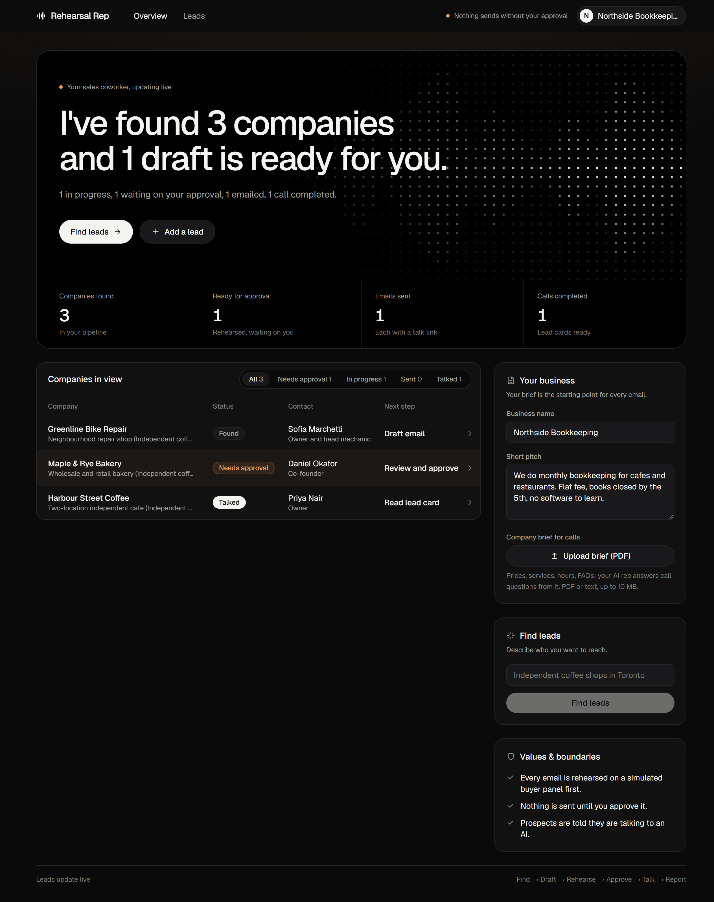
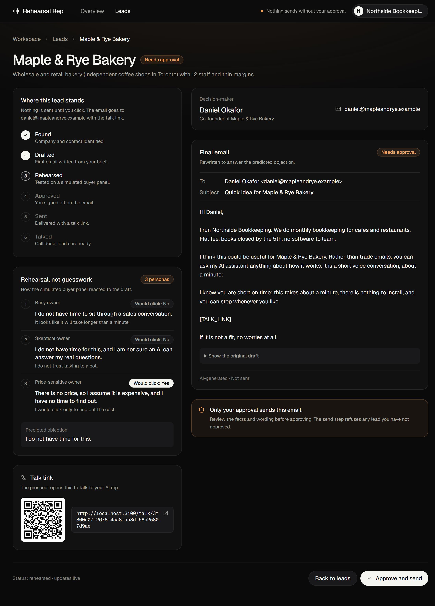
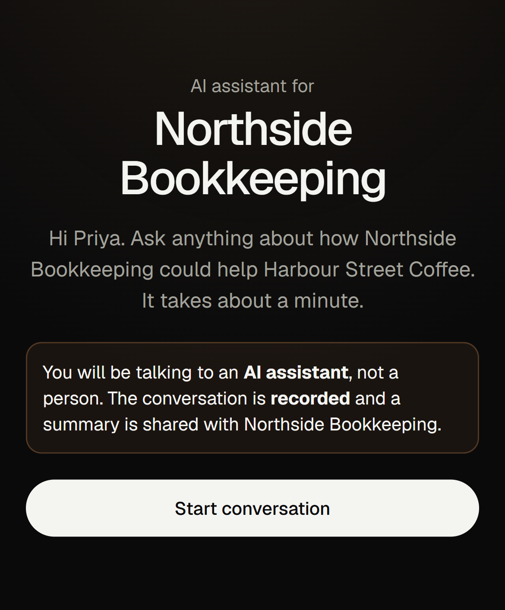
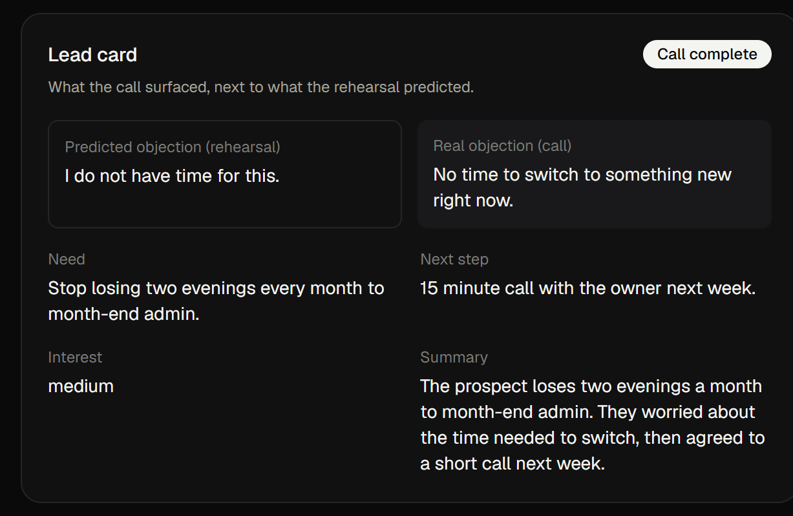
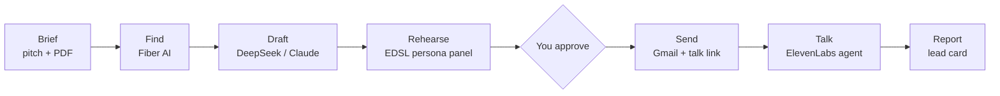

<h1 align="center">Rehearsal Rep</h1>

<p align="center">
  <b>An AI sales rep that rehearses on a simulated buyer before it emails the real one,<br/>
  then takes the call the moment they are curious.</b>
</p>

<p align="center">
  Built in one day at the <b>YC Startups x ElevenLabs Hackathon</b> (University of Waterloo, Nov 22, 2026).
</p>

<p align="center">
  
  
  
  
  
  
</p>

<p align="center">
  <a href="https://youtu.be/3ajm6sj80j8">
    
  </a>
  <br/>
  <a href="https://youtu.be/3ajm6sj80j8"><b>▶ Watch the demo: the full loop, working end to end</b></a>
</p>

## The idea

A solo business owner has no time for outbound sales, and a cold email gets one
shot. Rehearsal Rep does the whole job, start to finish:

1. **Brief.** You enter your business name and a short pitch, and can upload a
   company brief (PDF or text) with prices, services and FAQs.
2. **Find.** Describe who you want to reach. It finds companies and the
   decision-maker at each one.
3. **Draft.** It writes a first email for each lead from your brief.
4. **Rehearse.** A panel of AI personas modelled on that buyer reads the draft.
   Each one gives their main objection and says whether they would click. The
   most common objection becomes the *predicted objection*, and the email is
   rewritten once to answer it.
5. **Approve and send.** You read the final email and click approve. Nothing
   leaves without that click.
6. **Talk.** The email carries a link. The prospect opens it, usually on a
   phone, and talks to an ElevenLabs voice agent that knows your business and
   theirs.
7. **Report.** When the call ends, a lead card shows what they need, their
   real objection next to the predicted one, the agreed next step and their
   interest level.

## What it looks like

Screenshots are from the keyless mock walkthrough ([run it yourself](#run-it-yourself)),
with sample leads. The video above shows the real thing.

### The dashboard

Your pipeline at a glance, updating live as leads move through each step.

<p align="center">
  
</p>

### Rehearsal, not guesswork

Before you see the email, three simulated buyers have already reacted to it.
The lead page shows each persona's objection, the predicted objection, and the
email rewritten to answer it. Only your approval sends it.

<p align="center">
  
</p>

### The prospect talks to your rep

The talk page tells the prospect up front that they are speaking to an AI and
that the call is recorded. The agent answers from your brief, asks what they
need, surfaces their concern and proposes one next step.

<p align="center">
  
</p>

### The lead card

After the call, the predicted objection sits next to the real one.

<p align="center">
  
</p>

## How it works



Everything hangs off one table, `leads` ([supabase/schema.sql](supabase/schema.sql)).
Each part reads rows in one status and writes the next, which is how four
people built it in parallel without stepping on each other.

| Status | Written by | Picked up by |
|---|---|---|
| `found` | `/api/find` or manual add | `/api/draft` |
| `drafted` | `/api/draft` | Buyer panel (Maritime agent or `panel/panel.py`) |
| `rehearsed` | Buyer panel | Approve button on the lead page |
| `approved` | Lead page | `/api/send` |
| `sent` | `/api/send` | Prospect opens the talk link |
| `talked` | `/api/postcall` webhook | Lead card on the lead page |

### Built with

| Part | Tool | What it does here |
|---|---|---|
| Voice | [ElevenLabs Agents](https://elevenlabs.io/agents) | The live conversation on the talk page. A post-call webhook returns the summary plus four extracted fields: need, main objection, next step, interest level. |
| Rehearsal | [Expected Parrot EDSL](https://www.expectedparrot.com/) | Runs the persona panel: 3 to 5 simulated buyers each answer "what is your main objection?" and "would you click?" |
| Hosted panel | [Maritime](https://maritime.sh/) | Hosts the rehearsal agent so it runs when a draft is ready. A local script is the fallback. |
| Lead finding | [Fiber AI](https://fiber.ai/) | Turns "heads of support at mid-size e-commerce companies" into companies and contacts. |
| Drafting | DeepSeek, with Claude as fallback | Writes the first email from the seller brief and the lead's details. |
| App | Next.js 16 (App Router), React 19, Tailwind 4 | Dashboard, lead page, talk page and the API routes. |
| Data | Supabase (Postgres) | The single `leads` table. |
| Hosting | Vercel | The web app and webhook endpoint. |

### Guardrails

- **A human approves every email.** `/api/send` returns 409 for any lead that
  is not `approved`.
- **Prospects know it is an AI.** The talk page and the agent's first message
  both say so, and that the call is recorded.
- **No invented facts.** The agent answers only from your brief. Anything else
  gets "the owner can confirm it" and an offer of the next step.
- **Calls are short.** The agent is capped at 90 seconds.

## Run it yourself

You can run the whole loop with no API keys. Every integration falls back to a
mock when its key is missing. Needs Node 20+ and Python 3.10+.

```bash
npm install
cp .env.example .env.local
```

In `.env.local`, point Supabase at the in-memory stand-in:

```bash
NEXT_PUBLIC_SUPABASE_URL=http://localhost:54321
NEXT_PUBLIC_SUPABASE_ANON_KEY=anything
```

Then start three things, each in its own terminal:

```bash
npm run mock:db                          # in-memory database (lost on restart)
```

```bash
npm run dev                              # app on http://localhost:3000
```

```bash
python -m venv panel/.venv
source panel/.venv/bin/activate          # Windows: panel\.venv\Scripts\activate
pip install -r panel/requirements.txt
python panel/panel.py --mock             # buyer panel with canned objections
```

### The mock walkthrough

1. Open `/` and enter your business name and pitch.
2. Click **Find leads** (three sample leads) or add one by hand.
3. Open a lead and click **Draft email**. Status: `drafted`.
4. Within 5 seconds the panel moves it to `rehearsed` and the page shows the
   panel, the predicted objection and the final email.
5. Click **Approve and send**. The email is printed in the dev server log.
   Status: `sent`.
6. Open the talk link and click **Simulate call**. Status: `talked`.
7. Back on the lead page, the lead card shows the predicted objection beside
   the real one.

`npm run seed` adds one lead in each status if you just want to look around.

### With a real Supabase project

Create a project, run [supabase/schema.sql](supabase/schema.sql) in the SQL
editor, then set `NEXT_PUBLIC_SUPABASE_URL`, `NEXT_PUBLIC_SUPABASE_ANON_KEY`
and `SUPABASE_SERVICE_ROLE_KEY` in `.env.local`. `npm run check` tests each
key with a cheap read-only call and never prints the values.

## Turning on each real integration

Restart `npm run dev` after editing `.env.local`, and set the same values in
Vercel.

| Integration | Set | Mock behaviour when unset | Notes |
|---|---|---|---|
| DeepSeek (draft) | `DEEPSEEK_API_KEY` | Falls back to Claude, then a canned email | Model `DEEPSEEK_MODEL` (default `deepseek-chat`), JSON mode. [app/api/draft/deepseek.ts](app/api/draft/deepseek.ts) |
| Claude (draft fallback) | `ANTHROPIC_API_KEY` | Canned email | Used only when `DEEPSEEK_API_KEY` is empty. [app/api/draft/claude.ts](app/api/draft/claude.ts) |
| Fiber AI (find) | `FIBER_API_KEY` | Three sample leads | Set `FIBER_DEBUG=1` to log the raw response. Email reveal costs credits. [app/api/find/fiber.ts](app/api/find/fiber.ts) |
| Gmail (send) | `GMAIL_USER`, `GMAIL_APP_PASSWORD` | Email logged, lead still moves to `sent` | App password from Google Account > Security > 2-Step Verification > App passwords. |
| ElevenLabs (talk) | `NEXT_PUBLIC_ELEVENLABS_AGENT_ID`, `ELEVENLABS_API_KEY`, `ELEVENLABS_WEBHOOK_SECRET` | **Simulate call** button | Agent setup: [docs/elevenlabs-agent.md](docs/elevenlabs-agent.md). `npm run agent:sync` pushes the prompt from that file to the live agent. Setting the webhook secret disables Simulate call. |
| Buyer panel (rehearse) | `PANEL_SERVICE`, `PANEL_MODEL`, `PANEL_LOCAL_INFERENCE=1` with a provider key, or `EXPECTED_PARROT_API_KEY` | Run with `--mock` | `python panel/panel.py --personas 5` for a bigger panel, `--once <lead_id>` for one lead. |
| Maritime (hosted panel) | `MARITIME_API_KEY`, `MARITIME_AGENT_ID` | Lead stays `drafted` for the local script | Deploy steps: [docs/maritime-deploy.md](docs/maritime-deploy.md). |
| Talk links | `NEXT_PUBLIC_APP_URL` | Uses the request origin | Set to the deployed URL so emailed links work. |

Emails are drafted with the placeholder `[TALK_LINK]`. `/api/send` swaps in the
real link and appends the sender name and an unsubscribe line.

## Deploy

Push to GitHub, import into Vercel and add the env vars above. Then set the
ElevenLabs post-call webhook to `<deployed url>/api/postcall`.

## Project layout

```
app/
  page.tsx                 dashboard
  lead/[id]/               lead detail, LeadCard
  talk/[id]/               prospect page: VoiceCall (ElevenLabs), SimulateCall (mock)
  api/
    brief/                 reads the text out of an uploaded PDF or text brief
    find/  leads/          Fiber search, manual add
    draft/                 DeepSeek, Claude fallback, canned email
    rehearse/              triggers the hosted panel on Maritime
    send/                  approval check, Gmail
    postcall/              ElevenLabs post-call webhook
components/                AppShell, DotWave, StatusBadge, small UI pieces
lib/                       types, Supabase clients, brief and talk link helpers
panel/panel.py             local polling panel (fallback)
maritime-agent/            hosted panel: server.py, start.py, rehearse.py, Dockerfile
scripts/                   seed, mock Supabase, key check, ElevenLabs agent sync
supabase/schema.sql
docs/                      agent setup, Maritime deploy, demo script
```

More detail: [ElevenLabs agent setup](docs/elevenlabs-agent.md),
[Maritime deploy](docs/maritime-deploy.md),
[the demo script](docs/demo-elevenlabs.md) and
[the original build prompt](MVP_PROMPT.md).

## Known gaps

This is a one-day hackathon build, not a product.

- **No auth.** Anyone with the app URL can read and edit leads. Fine for a
  demo, not for real customer data.
- Fiber response parsing was written against partial docs; see the TODO in
  [app/api/find/fiber.ts](app/api/find/fiber.ts).
- The seller brief lives in the browser's localStorage, so it is per device.

## Team

Four people, four lanes, one table.

| Lane | Owner | Files |
|---|---|---|
| Buyer panel | Shukun | `panel/`, `maritime-agent/` |
| Dashboard and lead page | Sean | `app/page.tsx`, `app/lead/`, `components/` |
| Talk and report | Dylan | `app/talk/`, `app/api/postcall/`, `docs/elevenlabs-agent.md` |
| Find, draft, send | Kashyap | `app/api/find/`, `app/api/draft/`, `app/api/send/`, `app/api/rehearse/` |
